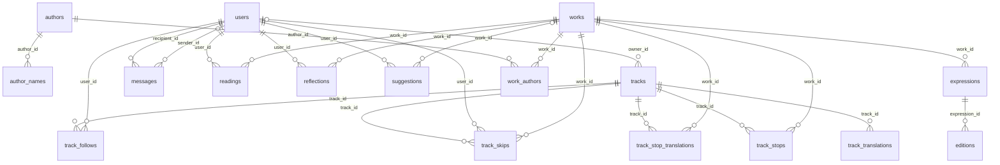
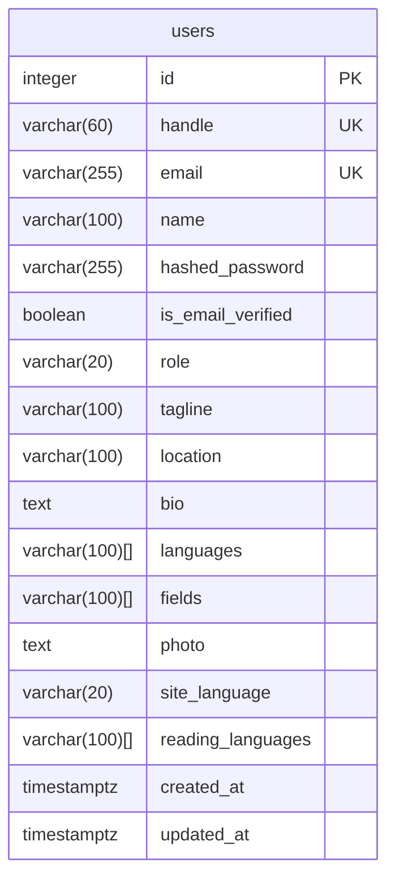
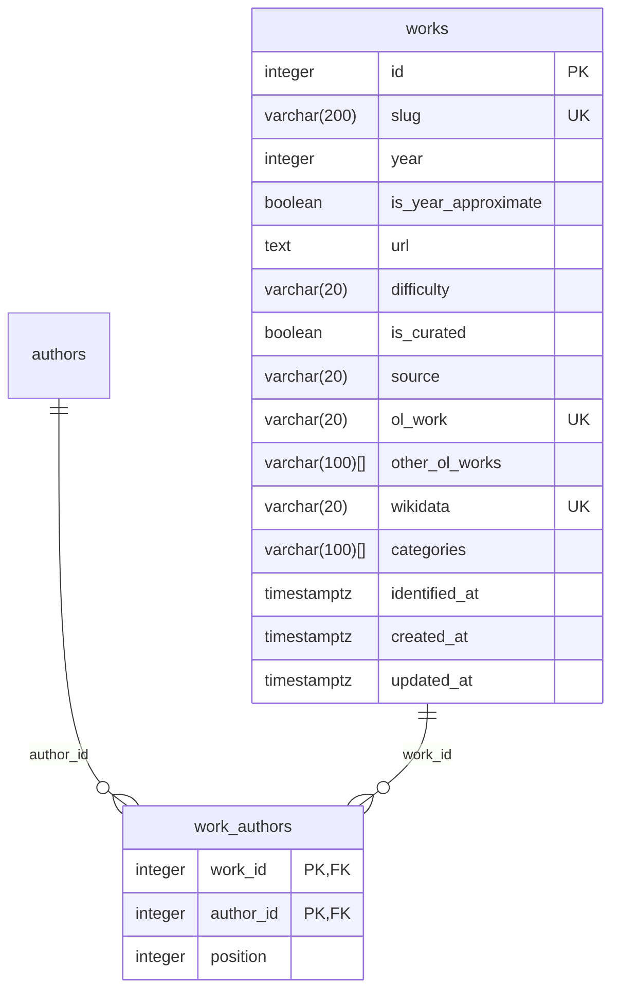
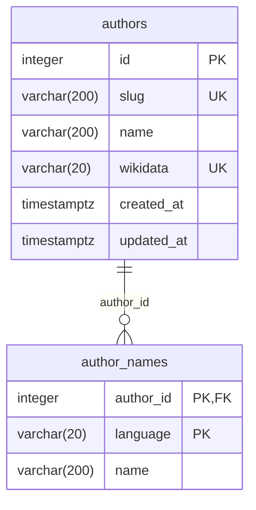
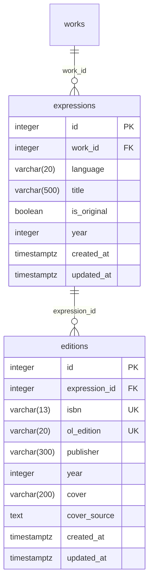
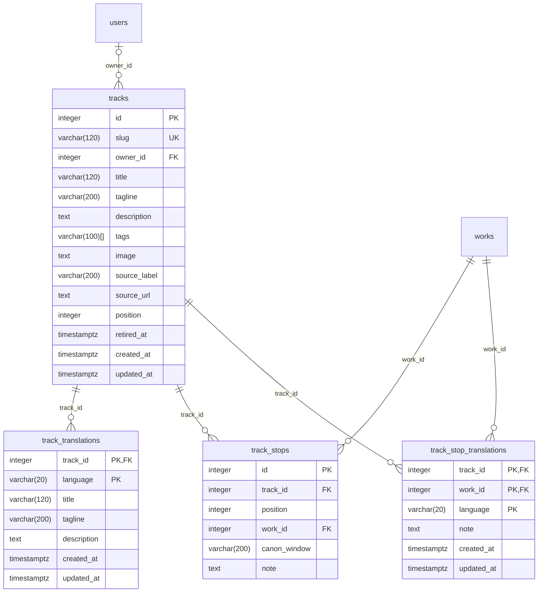
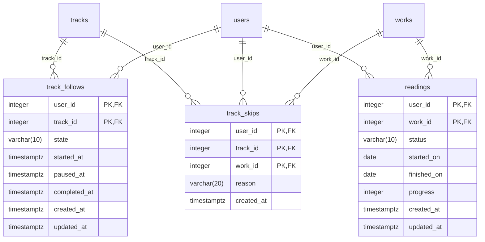
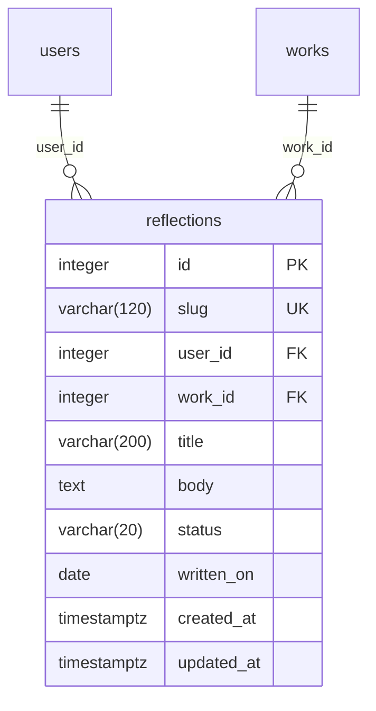
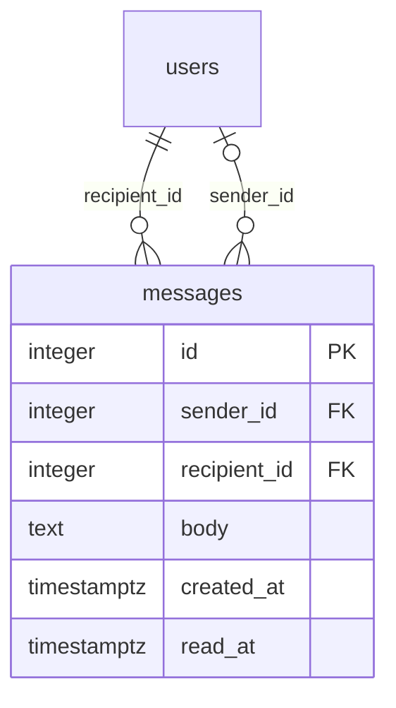
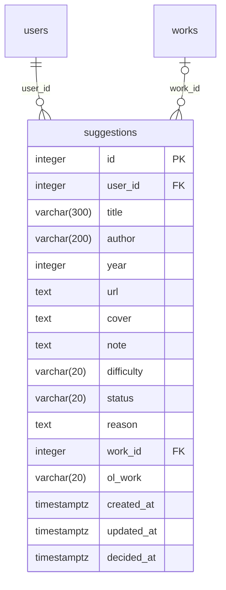

# Data model

The tables in the database, drawn from `backend/models/` by `make erd`. Don't edit this file: change the
models and run it again. CI checks it's up to date.

## Terms

The words come from the library standard IFLA LRM, and mean the same in the code, the database and
the API:

- **work**: a book as its author made it, in any language or print: Bonita Avenue, by Peter Buwalda.
  Readers read works, follow them on tracks and write reflections about them. The site calls them
  books.
- **expression**: one text of a work in one language, with its own title: the Russian original "Война
  и мир", or the Dutch translation "Oorlog en vrede".
- **edition**: one publication of an expression, with its year, publisher, cover and ISBN: the Pushkin
  Press paperback of 2014 of the English Bonita Avenue.

A work holds what's true in any language: who wrote it and when it first came out. Its titles are on
its expressions. A reader's status is for the work, whatever language or edition they read. They
see titles in their reading languages (`users.reading_languages`) and the site in their own
(`users.site_language`). Authors have names in other languages too (`author_names`), so a Russian
reader sees "Лев Толстой".

## Diagrams

Keys: PK primary key, FK a link to another table, UK unique. A line between two tables is one of
those links, named by its column: `||` exactly one, `|o` one or none, `o{` any number.

## Everything

Every table and how they're linked; their columns are below, by subject.

## Users (`backend/models/users.py`)

Readers: the user table, public profiles and account settings.

## Works (`backend/models/works.py`)

Works: what readers call books. Their titles are on their expressions.

## Authors (`backend/models/authors.py`)

Authors of works, and their names in other languages.

## Expressions (`backend/models/expressions.py`)

A work's expressions and editions. An expression is one text of a work in one language, with its own title. An edition is one publication of an expression. A work's cover is a special edition without an ISBN: a work has one cover, not one per edition or language.

## Tracks (`backend/models/tracks.py`)

Reading tracks: ours and the ones readers make, and their stops in reading order.

## Reading (`backend/models/reading.py`)

A reader's bookshelf: their status for each work, and the tracks they keep.

## Reflections (`backend/models/reflections.py`)

Reflections: essays readers write about works they read.

## Messages (`backend/models/messages.py`)

Messages between readers, plain text only, and from OpenRead itself.

## Suggestions (`backend/models/suggestions.py`)

Works readers suggest for the catalogue, and the admins who review them.

